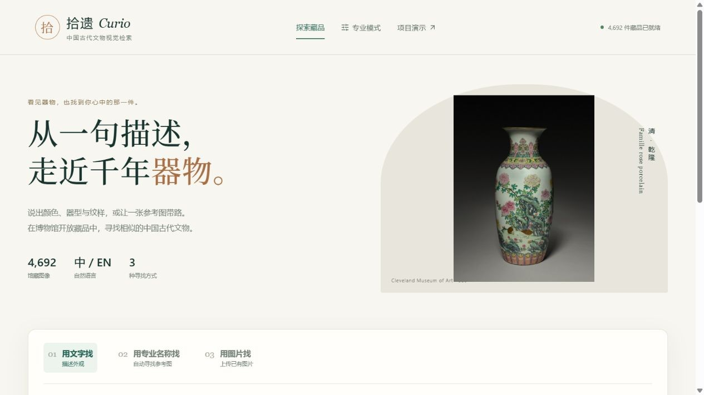
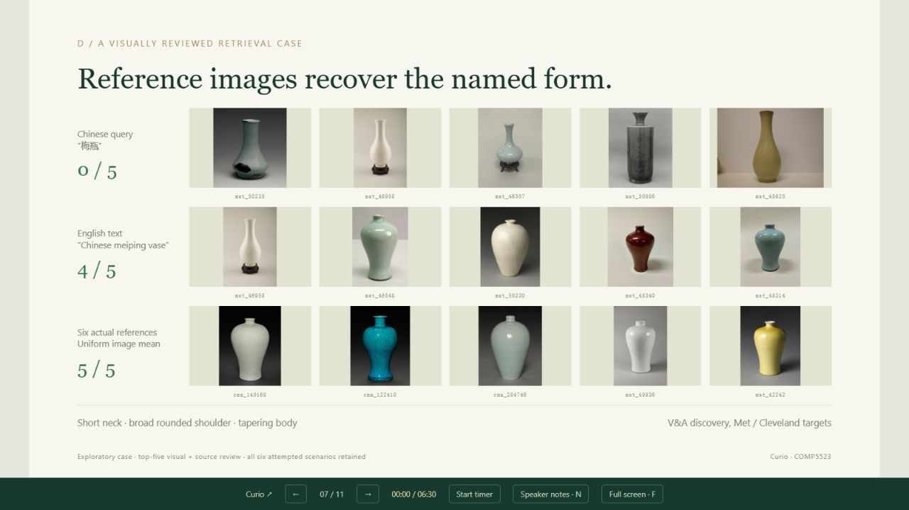

# Showcase v6验收 · 2026-11-09

- 后端完整测试：511 passed，10 warnings；日志artifacts/frontend_v6_pytest.log。
- Ruff全src/tests/scripts通过，TypeScript/Vite构建通过。
- 浏览器实际操作：外观组合文字检索48结果；完整集合1,137结果、95页，已翻到第二页；专业模式梅瓶取得6张真实V&A参考，前五结果与实验一致；上传梅瓶图返回48结果；馆藏详情和来源；专业模式EN/ZH图表；实验档案返回入口。
- 演示逐页截图检查；梅瓶页图像、ID与注释已消除拥挤。1280×720视口下无坏图。
- 视频元数据60秒、1280×720、readyState=4；浏览器实际播放到34秒，错误为空。
- API重放见showcase_api.json：三种dev集合方法均与单查询独立重放一致，top_k只限制preview；8张缓存参考图片路由解码通过，候选馆藏文字不参与排名。
- API重放与离线批量存在一张HSV阈值附近判定差异，原始数值保留在JSON；展示期间没有改标签或阈值。
- Release发布6个附件，大小和SHA256全部远端核验；收据docs/showcase_upload_receipt.json。

代码分支codex/research-showcase-v6；草稿PR #1，附在当前聊天。发布说明见../SHOWCASE_RELEASE.md。

