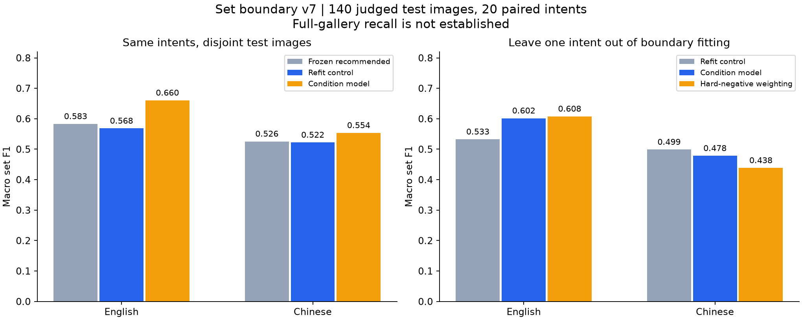

# 全库 yes/no 集合边界：第一轮实验报告

日期：2026-11-12。本报告保留当时的研究结论；2026-11-15 已按用户授权切换本地默认方法，部署验证见 [DEPLOYMENT.md](DEPLOYMENT.md)。基于 `codex/research-showcase-v6` 的提交 `59af1e6`，独立工作分支为 `codex/set-boundary-experiments`。

**结论：增加条件级分数和单条件替换对照，改善了当前已知查询上的集合质量；但中文向留出意图迁移仍不稳定，暂不替换生产默认算法。**

本轮实际完成了资源恢复与哈希校验、评分可分性诊断、条件特征实现、分组交叉拟合、完整对照实验、全库输出重放和边界标注队列。不是仅列方案，也没有把事后最优阈值当作新算法成绩。

## 1. 先判断问题来自哪里

复用了全库 4,692 张图片的冻结 SigLIP2 production LoRA 分数，在原有 140 张 test 图片、20 个语义意图上分析正负例。以 grade=3 为相关，部分匹配为负例；未知标签单独报告。

原始分数的逐查询事后最优阈值能达到：英文宏 F1 **0.7458**、中文 **0.6829**。这比当前共享阈值高，说明阈值选择存在改善空间；但这是使用测试答案计算的诊断上限，不能部署，也不是泛化成绩。

不同查询的问题不同：

| 查询 | 英文事后最优 F1 | 中文事后最优 F1 | 解读 |
|---|---:|---:|---|
| 乾隆时期瓷器 | 0.0755 | 0.2353 | 当前分数严重混淆，测试正例仅 2 张；不能靠外观确认年代 |
| 带盖罐 | 1.0000 | 0.4000 | 同一概念的中英文表示有明显差异；仅 4 个测试正例 |
| 带柄/耳容器 | 0.5455 | 0.4375 | 原始分数不足以可靠区分条件 |

完整逐查询 AP 和诊断上限见 `diagnostic_summary.json`。PR 图及正负例分布保存在 `artifacts/set_boundary_v7/`。

## 2. 实现了什么算法

保留原始图文相似度、通用提示词差值和标准化分数，新增条件分数的均值/最小值、对照差值的均值/最小值，以及条件覆盖率和条件数。

例如“绿色瓶”拆成“瓶”和“绿色”，对照描述每次只替换一个条件：绿色碗、绿色盘、红色瓶、蓝色瓶。模型学习这些差值是否有助于判断相关，不直接用某个属性一票否决。颜色/纹饰可能共存，因此对照不是人工真值。

条件来自现有查询规格，不读取候选图片对应的馆藏元数据。固定 SigLIP2 文本塔只编码新描述，复用既有图像向量。年代、特定工艺等未支持条件显式记录缺失；缺失标记并不自动阻止模型输出 yes，因此结果不代表历史身份已确认。

训练使用固定 C=1 的标准化逻辑回归。只在 60 张 dev 图片上按器物组做三折交叉拟合，使用折外分数选择共享 F1 阈值，然后在全部 dev 上重拟合。另比较 grade=1 部分匹配负例权重设为 2 的版本。没有根据本轮 test 结果反复调参。

## 3. 已知意图、不同测试图片

| 方法 | 英文宏 F1 | 中文宏 F1 |
|---|---:|---:|
| 原有共享阈值 | 0.5292 | 0.5257 |
| 原有逻辑回归 | 0.5734 | 0.5149 |
| 原有 HSV 辅助 | 0.5831 | 0.5240 |
| 本轮同协议三特征基线 | 0.5682 | 0.5221 |
| **新增条件特征** | **0.6604** | **0.5536** |
| 条件特征＋部分匹配负例加权 | 0.6178 | 0.5179 |

相对原有各语言最好的方法，新条件模型增加约 **7.73 / 2.79 个 F1 百分点**。为了区分“训练流程改变”和“新增证据”的作用，本轮另设了相同交叉拟合流程的三特征基线；相对它的提升为 **9.21 / 3.14 个百分点**。

提升存在 precision/recall 取舍。英文新模型 micro precision/recall 为 **0.6130 / 0.7857**，原有 HSV 为 **0.6209 / 0.5198**；英文主要改善召回。中文新模型为 **0.6629 / 0.7024**，原有共享阈值为 **0.4427 / 0.7817**；中文提高精度的同时牺牲了一些召回。

同协议比较中，将每个意图的中英文差值先平均，再按 20 个意图做 2,000 次配对 bootstrap：条件特征平均 F1 增益 **0.0618**，探索性 95% 区间 **[0.0108, 0.1233]**。该区间未校正多个方法比较，也不包含标注不确定性，不能据此宣称普遍优越。

提升也不是逐查询一致的：英文人物、细长颈和倾倒器改善较多；青铜、龙纹等有所下降。中文人物、瓷器和细长颈改善，但倾倒器、带柄容器、带盖罐下降。逐查询结果见 `per_query.csv`，不能只看总体均值。

## 4. 留出完整查询意图

每次只用其余 19 个意图在 dev 图片上训练和选阈值，测试留出意图的 test 图片。

| 方法 | 英文宏 F1 | 中文宏 F1 |
|---|---:|---:|
| 同协议三特征基线 | 0.5326 | 0.4988 |
| 新增条件特征 | 0.6016 | 0.4783 |
| 条件特征＋负例加权 | 0.6078 | 0.4384 |

**英文仍有改善，中文下降。** 条件模型相对同协议基线的双语平均增益为 0.0243，探索性 95% 区间 **[-0.0713, 0.1216]**，跨过零。这轮结果不足以证明新查询上的稳定提升。

LOIO 只对“边界分类器的训练意图”做隔离。词汇表、预训练模型、既往模型选择并没有完全隔离这些概念，因此不能把它包装成真正全新概念的测试。

## 5. 工程验证与产物

- 在独立 Python 3.12.16 环境中运行，PyTorch 2.9.1；依赖版本见 `environment.json`。
- 原有 6 个语言/方法基线宏 F1 全部复现。
- 新加载的文本塔与缓存向量余弦一致性最低约 0.9999998；重算原始图文分数与冻结矩阵最大误差约 2.38e-7。
- 保存模型后重放了 **1,126,080 次候选判定**，全部入选 ID 与保存集合一致，测试 F1 一致；保存 float32 分数的最大误差约 2.98e-8。
- 已验证留出意图不出现在对应边界模型的训练 qid 中。
- 新增及关联测试 **17 项通过**，修改文件 Ruff 检查通过。没有声称跑过整个后端测试套件或线上 UI 验收。
- 生成 **400 行**待标注队列，全部来自已审阅核心之外，标签留空。完整证据见 `verification.json`。

代码入口与复现命令见本目录 `README.md`。原始分数、拟合参数、全部入选集合和图表保存在 `artifacts/set_boundary_v7/`；本目录保存小型可分享的结果与报告。生产默认方法和已发布 v5 数字未改动。

## 6. 下一步应该做什么

建议保留条件模型作为研究候选，先补独立标注和中文失败分析，不继续在同一个小 test 上搜索超参数。

1. 先审阅 `annotation_queue.csv` 中的边界样本，重点看部分匹配、细小结构、颜色共存及未知历史条件。这些样本用于训练，不能当无偏测试集。
2. 预先固定新的查询意图，包含复合条件和确实没有匹配项的查询。按器物组隔离新的测试图片；至少对少量查询完整审阅图库，才能验证全库召回。
3. 中文优先检查条件描述与整句查询的差异。若试验中英共享条件表达，应作为新版本实验预先固定，不在本轮结果上反复挑提示词。
4. 如果细部条件仍混淆，再引入局部视觉证据或图文联合匹配模型。独立数据充分后，再研究 precision/recall 目标阈值及风险控制。

本轮回答的是“新增条件证据是否值得继续”：已有积极的同意图证据，同时暴露了中文迁移和历史条件的明显限制。还没有实现一个能对任意查询准确划分全库的最终边界。
