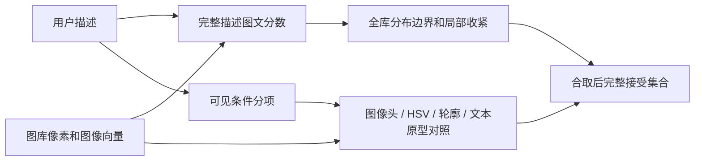

# Curio 技术报告草稿：面向中国古代器物的文本到图像检索

技术研究草稿，2026-11-08。只覆盖数据、方法、训练、实验与失败分析；组员贡献、前端开发经过、同侪评议和最终展示由小组另行讨论。
本稿按课程原始 specification 的领域检索、相关性定义、方法比较、效率和失败分析要求组织。
课程允许使用 CLIP 或 caption/tag 方法；采用向量检索本身符合任务。研究重点是检验哪些视觉表示与工作流能处理本领域的不同查询难度。

## 研究问题和输入边界

用户可能只输入“瓷器”，也可能描述“绘有荷花的青花碗”，或给出“康熙梅瓶”等专业表述。
我们将问题分为三个难度，并增加集合式决策：

1. 大类：区别陶瓷、金属、织物等器物家族。
2. 可见细节：同时匹配器型、颜色、形状和纹饰；检验领域适配和独立视觉特征是否改善结果。
3. 专业表述：通过外部馆藏 API 的文本搜索获取参考照片，再以图图匹配寻找本地图像中的近似对象。
4. 返回边界：从固定 Top-K 展示扩展为一次全库查询返回数量不固定的符合候选集合。

主要推理模式只使用候选图片的像素或由像素得到的向量/预测，不读取候选标题、年代或描述参与排序。
馆藏文字用于训练监督、参考照片的出处记录、结果展示及单独的元数据辅助对照。
训练时使用标签与查询时直接匹配目标标签是不同操作：分类头学到的参数在线接收图像特征，图库没有描述时仍可运行。

## 数据及相关性协议

主图库含 4,692 张记录：Met 2,954、Cleveland Museum of Art 1,738，具有原始来源和图像许可记录。
以官方 accession、部件关联、related works 和重复图关系组成 4,234 个对象组，按组划分 train/dev/test 为 3,474/568/650。
同物不同视图不能跨训练和留出边界。冻结快照为 `data/snapshots/collection_v2.jsonl`，SHA256：
`4dbb5e4045bbab4fd245f7fce2d2fc363aabfe41a45d31b91703ddaac5ebee68`。
另有可选 4,793 图扩展库，不能直接套用主图库的实验分数。

评估任务必须分开解释：

| 任务 | 样本与相关性 | 回答的问题 |
|---|---|---|
| 主视觉自由查询 | dev/test 各 60 图、24 意图，逐意图穷举 0–3 级 AI 读图相关性 | 小图库的开放描述排序 |
| 后续 CV 表示对照 | 218 训练、48 dev、96 test 图，21 固定可见属性意图 | 同样属性桥下比较视觉表示 |
| 馆藏监督分类 | 官方字段派生的已知单一类别，缺失/多值按任务排除 | 图像表示是否含器型、材料等信息 |
| 全库集合观察 | 8 条探索查询，读取强匹配、随机接受和拒绝侧样本 | 返回边界是否出现明显不合理行为 |
| 专业参考图观察 | 实际 API 搜索及独立参考照片，全 4,692 图排序 | 专业文字能否转化为可用图像查询 |

主视觉相关性为 AI 看图审计，不冒称真人 gold。二值相关为 grade≥2，P@5 为前五张相关比例；
nDCG@10 使用 `2^grade-1` 增益，AP@10 分母为完整已知相关图数。查询的中英文表述分别报告，不能当作两倍独立语义样本。
整图分类 Macro-F1 是每图单一类别任务，不含“Top-K 尾部误收”这个环节；不能把它解释为检索集合正确率。

对馆藏字段曾进行实际图像和官方说明复查，发现混合材质、用途词与可见纹样、单标签多主题等问题。
修订保留原文及逐件变更记录，避免把未描述当作不存在。它只是支持训练与补充分析的清理工作，不是本报告的研究中心。
在这些标准尚不完备时，本轮没有继续堆叠自动评分来宣称检索进步。

## 阶段一：基础图文表示

基线为 CLIP ViT-B/32，比较第一代 SigLIP B/16-224、SigLIP2 B/16-224。
内部早期目录名 `artifacts/siglip` 实际对应 `google/siglip2-base-patch16-224`，不能把它误写为第一代 SigLIP。
文本和图像经各自编码器投影并归一化，以余弦相似度排序；图库图像向量离线缓存。
在 4,692 图规模上精确矩阵内积已足够快，增加预筛本身未必节省时间。

同一后续 96 图、21 意图实验中，原始英文查询 P@5 分别为 CLIP .600、SigLIP1 .724、SigLIP2 .752、生产 LoRA .762。
这支持该受限条件下选择更强图文表示，但不是全图库准确率；第一代在部分中文条件下更高，模型升级不是所有语言和属性的单调提升。
原始结果与完整协议见 `docs/CV_BACKBONES_20261104.md`。

| 全库图像编码，RTX 3070、batch 16 | 4,692 图总时间 |
|---|---:|
| CLIP B/32 | 126.4 s |
| SigLIP1 B/16 | 113.9 s |
| SigLIP2 B/16 | 104.4 s |
| 生产 SigLIP2-LoRA | 102.5 s |
| DINOv2 FP32 | 122.0 s |

时间包含读图、预处理、图像塔和归一化回传，排除下载、模型加载和索引保存；文件缓存及设备时钟不是严格控制变量。
这些是本机端到端成本，不能用几秒差值证明某模型架构必然更快。离线建立向量的成本也不能从在线时延中消失，应分别报告。

## 阶段二：领域适配、细节及返回边界

### 训练与辅助图像头

实现图像 attention 的 q/v LoRA，文本塔冻结，采用多正例 InfoNCE 和 teacher 特征锚定。
比较馆藏弱监督 caption、218 张有效 AI 像素 caption、随机采样和近邻 hard batch。
caption 的制作或馆藏字段参与离线监督，不等于在线读取某候选的 caption 决定相关性。
epoch、分类正则化和重排权重按 dev 选择；生产冻结配置为 `siglip_adapted` 的 image_only，属性头排序权重 0。
它是馆藏 caption 适配的图像塔，另一套 visual-caption LoRA 保留为研究对照。

小图库视觉 caption 配对中，SigLIP2 与两套 LoRA 的 R@5 都已达 1.0，因此不能用配对饱和指标证明复杂自由查询已解决。
原主实验中 SigLIP2 的中英平均 dev nDCG@10 约 .8605，馆藏 caption LoRA 为 .9175，visual-caption LoRA 为 .8870；
这些是 dev 选择依据，正式 test 分语言和置信区间见 `docs/VISUAL_RESULTS.md`。
正权重属性头没有普遍改善开放描述排序，不能把“添加了分类头”直接写成效果提升。

独立的图像属性实验把 HOG/HSV/LBP、DINO 或 SigLIP2 图像表示连接到相同线性分类桥。
在同 96 图、21 意图的 known-only P@5 中，raw classical .648、GrabCut classical .762、DINO .743、
dev 选择的 DINO+.25 raw classical .829、SigLIP2 图像头 .886。
这是固定可见属性的封闭任务，说明传统特征能提供信息，也说明不能拿这个 .886 替代开放图文查询的 .752。
类别不支持时需要弃权；年代、真伪、内部结构不属于上述可见属性能力。

### 可变长度集合算法

固定 Top-K 永远能返回五张图，不能回答哪些图片应当被接受。
本轮新增全库分布边界，先计算查询余弦与通用 museum-object 提示余弦之差，再用 BIC 支持的双高斯高支持分量建立初选。
若初选中仍存在明显层次，对原始查询分数作局部双高斯收紧；显著弱的全查询返回空集合。
之后以器型/材质图像预测、前景 HSV、可用轮廓以及分项视觉文本原型共同检查请求的必要条件。
例如“青花荷花碗”分解为碗形、蓝白外观和莲花装饰，不能仅因“像碗”或“有花”就接受。

接口 `POST /api/search/set` 返回全体接受图片，`top_k` 仅限制 preview。
分布 posterior、原型分数和图像头输出均不是校准的“检索正确概率”。
探索性读图发现，分项条件能排除竹纹碗、单色碗、黑白照片和部分织造物误收；严格合取同时造成合理器物的遗漏。
例如绿色瓶查询中 `met_48602` 被窄口原型排除，莲花碗中深蓝莲花造型器 `met_47898` 仍被当成莲花纹器。
这是形状与纹饰语义混淆及严格边界牺牲召回的实例，已保存返回和拒绝侧图，不只展示强匹配。
完整算法、8 查询数量及实际图片判断见 `docs/VISUAL_SET_ALGORITHM_20261108.md`。
本轮把它交付为可运行研究框架，没有用不完整标签报告全库集合 precision/recall。

## 阶段三：专业描述 → API 参考图 → 图图检索

这一阶段的核心实验应当是直接文本搜索外部数据库，而非从事先为八条查询挑好的照片中选答案。
用户描述或明确披露的英文搜索文本直接提交到博物馆 API；保存 API 查询 URL、原始命中顺序、图片下载记录及来源说明。
从 API 命中中取得许可可用、与本地目标对象及照片隔离的参考图，再对参考和图库像素编码。
目标图库的年代、标题和标签不进入图图排名。

开发中曾增加专业词规则、年代和器型筛选、掩码检查；这使主线偏向“先按自定义规则认定参考图”。
用户明确要求恢复直接 API 文本检索，因此该严格筛选路线只作为历史/可选对照，不将它冒称为直接 API 返回的结果。
直接模式已执行并记录于 `docs/DYNAMIC_REFERENCE_RUNTIME_20261108.md`，审核时以该模式的实际产物为准。

完整英文搜索文本 `Qianlong famille rose porcelain` 原样提交给 Cleveland 与 Met，分别返回 16、22 个对象 ID。
本轮最终直接采集实际执行 48 次网络请求、0 次缓存读取，检查 38 个命中，下载 8 张图片，其中 1 张被图像隔离排除，
保留 7 张外部参考。没有人为挑选固定答案，也没有按项目年代/器型词表重新认定 API 的搜索相关性。
查询 URL、原始命中顺序、下载与排除原因、参考向量和全库结果位于
`artifacts/dynamic_reference_runtime_20261108/direct/fresh_qianlong_final/`。

主代理和 Sol 都实际打开了最终参考图、SigLIP 均值、DINO 均值和融合结果图。
API 命中包括白色内壁视图 `cma_140220`、多碗合照 `cma_123596`、带人物/装架的 `met_205810` 和欧洲式器物 `met_201732`，
这些现象说明源搜索可能因馆藏文字的关联而命中，并不只提供标准正面“乾隆粉彩”照片。
融合返回可见装饰瓷盘、盆和瓶，第一项 `met_52032` 接近盆形参考；不少黑白照片也因外形、纹饰进入前排。
因此本轮证明了直接 API 文本检索到图图匹配的真实执行链，尚未证明它在专业身份精确性上优于直接图文检索。
这项负结果明确指向外部搜索噪声和参考组成偏差，不能靠重复调掩码来解决。

图图算法比较两个独立表示：SigLIP2 的图像语义和 DINO 的纯图像外观表示。
多参考分别计算与每张候选的相似度，比较平均聚合与多样性聚合：参考在两个空间相近时合并为视觉簇，每簇总权重相同，
每簇内部均分权重；以 .75 加权相似度与 .25 最佳参考相似度结合，避免同一外观的多张照片获得过多投票，也保留不同外观模式。
两路采用 .70 SigLIP、.30 DINO 的 rank fusion，系数是明确的工程设计，不是由新 test 得出的最优值。
无参考返回不足状态；单参考允许工作，但显式记录它不能代表整个专业类别。

初期读图中，“康熙梅瓶”的参考图确实形成了小口、高肩、收腹的相似器型召回；后排仍有长颈瓶和圆腹瓶。
“乾隆粉彩”的一张多碗合照使宽泛专业类别主要召回杯碗，显示参考组成会引入器型与构图偏差。
“万历青花”召回不少外观合理的蓝白盘瓶，但图像接近不等于年代被确认。
这些观察来自已运行的严格筛选对照；不能拿来替代直接 API 模式尚需核对的结果。
图像路径的价值在于把难直接编码的专业词连接到真实外观例子，不能由相似度推出同朝代或真实性。

## 阶段四：其他视觉算法、性能和负结果

### 传统视觉与去背景

比较整图、旧 GrabCut、边界颜色连通域、自行设计 v4 分割、384 像素 GrabCut 原前景及最大连通域。
提取轮廓投影、Hu、occupancy、HSV、HOG 和 LBP，单通道及拼接分别比较。
在固定 338 图的补充分类中，器型 shape 特征的 no-mask test Macro-F1 为 .194，dev 选择的旧 GrabCut 为 .374；
all 特征为 .488 对 .550（dev 选择的 384 raw）。器型可评估 test 仅 39 图，不能外推为全库检索收益。
大类材料的 dev 最佳反而是整图，故不默认在全部任务前删背景。

自主 v4 没有优于简单对照。24 张近似 mask 的 dev/test IoU 为 v4 .617/.598、border .696/.645、384 raw .705/.655；
这些 mask 不是独立精细人工 gold，而且已参与方法开发。实际检查可见：画面铺满的平面织物容易被当作背景，细提梁会被丢失，
填孔会改变真正的器物空洞。分割质量应联系下游任务判断，不能仅以一个 IoU 声称检索变好。
合成背景替换下前景 HSV 更稳定，但小样本器型图图检索没有证明稳定收益。
详细方法、失败图和计算时间见 `docs/BACKGROUND_DOWNSTREAM_20261108.md`。

### DINO 与预排除

DINO 没有直接接收中文专业描述的文本塔；本项目通过图像参考或训练的可见属性桥使用它。
在固定预算预筛中，保留半库的 DINO 平均已知正例保留率 94.3%，最差查询只有 67.6%；
按 dev 的高保留要求最终选择保留 100%。它可以作研究重排，不能宣传为无损排除器。
缓存向量条件下，全量余弦排序约 1.56 ms，DINO 半候选重排约 3.99 ms、融合约 6.28 ms，均排除共同文本编码。
该图库下额外通道比一次精确内积还贵，单为速度加入预筛没有得到支持。

### 提示词前后缀

比较 19 个模板，包含 `a photo of`、`image of`、博物馆提示、标点、大小写与后缀。
24 dev 意图选择每语言 nDCG@10 最佳模板，再在固定 24 test 意图补评，未用 test 反选。
英文选择去掉 leading article，test ΔnDCG@10=-.0044，95% CI [-.0256,.0137]；
中文选择 `image of`，Δ=.0040，CI [-.0303,.0406]，Holm 校正 p 均为 1。
因此不能把“加 a photo of 必然更好”当作本领域结论。
该 test 已在旧实验使用，是固定补充对照；细节见 `docs/PROMPT_CALIBRATION_20261108.md`。

## 可支持的研究结论

领域适配图文表示提供了实用的开放文本入口；在固定小图库上，SigLIP 系列优于 CLIP 的点估计具有一致的英文方向。
专门图像头和传统描述符能处理部分可见属性，但不同任务和评估集的分数不能混为同一排行榜。
全库分布边界与分项条件提供了可变数量的集合输出，当前最有价值的证据是实际暴露并减少了若干误收，同时记录了漏检。
参考图路线把专业描述转化为真实图像查询，其主要风险是外部搜索相关性、参考覆盖与外观相似并不保证专业身份相同。
更复杂的预处理和更多通道没有自动带来更好的性能；本项目保留无收益和失败结果，以质量与成本共同决定默认行为。

## 复现与 AI 使用说明

基础数据、模型训练和原始实验命令见 README；新集合脚本为 `scripts/inspect_visual_sets.py`，
动态参考入口为 `scripts/search_dynamic_references.py`，后端端点为 `/api/search/reference/dynamic`。
所有新研究产物和源代码仍位于本地工作区，未因本轮开发创建新的发布包或宣称旧 Release 已包含它们。

AI 用于代码、实验编排、图像读图和部分标注；独立 Terra 承担过批量图像标注，Sol 开发动态参考路径，主代理检查并整合。
馆藏原始描述与 AI 补充分别保存。AI 读图不是人工专家认证；不虚构组员标注、实际贡献或专家鉴定。
模型选择和实验限制随每组结果披露。论文参考文献应在最终稿中按实际所用模型及算法原论文统一补齐，
不以代码生成的解释充当文献来源。

正式提交前的剩余编辑包括：选少量成功/失败并列图、统一核验原论文文献、按课程 8 页格式压缩，
由组员确认任务归属和最终 AI 披露。这里不编造这些尚未讨论的部分。
