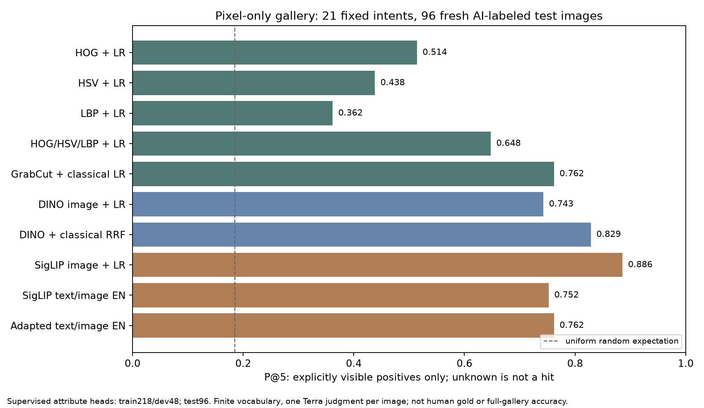

# 仅像素图库的文本检索：算法研究与第一轮实测

命名澄清：本页及历史索引中的 `SigLIP` / `siglip` 实际指 **SigLIP2 B/16-224**。CLIP、真正第一代SigLIP、生产LoRA相同属性头、全4692图编码开销及预筛漏检补充，见 [CV_BACKBONES_20261104.md](CV_BACKBONES_20261104.md)。

日期：2026-11-04。研究动机来自与 professor 的沟通：需要研究视觉表示、预处理、文本与视觉属性的对应和质量/计算取舍，系统界面只是实验载体。以下方法、标注、训练和测试均已实际运行，生产默认配置没有因此改动。

## 研究问题与当前结论

1. **不依赖图文预训练，能否从中文/英文检索可见属性？** 可以在明确的有限词汇内实现。固定文本解析器把查询变成属性合取，HOG/HSV/LBP/轮廓特征训练出的分类器仅从图片预测属性，再排序。没有读取候选图片的标题、馆藏描述、年代、真实标签来匹配。
2. **分割是否改善检索？** 此实验中 GrabCut 后的颜色与组合特征改善，HOG 和 LBP 的检索平均值反而下降。分割需要按特征和对象检查，不能统一宣称有益。
3. **经典特征能否补充纯图像深度表示？** 开发集选择的 DINO+经典特征融合在测试集优于 DINO 单独使用的点估计；描述性区间跨0，还不能声称稳定优势。
4. **级联一定更快吗？** 本次不成立。已有离线属性预测缓存时，粗排再重排增加了排序开销，而且召回不足会损害结果。需要把离线建库、在线查询和动态局部处理分开计量。
5. **是否证明可以替代所有 CLIP/SigLIP 查询？** 没有。SigLIP 图像特征加同样监督头在本任务上仍最好，有限属性路线不支持任意新概念、年代鉴定或复杂语义纹饰。图像表示为向量是常见计算形式；研究贡献应由可检验的假设、对照与失败分析支撑，而不是由是否使用向量判断。

## 数据、标注和隔离

基础图库仍为冻结4,692张，SHA256 `4dbb5e4045bbab4fd245f7fce2d2fc363aabfe41a45d31b91703ddaac5ebee68`。另生成严格三字段像素清单 `eval/cv_research_20261104/pixels.jsonl`：只有不透明ID、图片路径、图片SHA256。特征提取脚本拒绝含馆藏语义字段的输入。

- 训练：沿用218张原有AI盲图属性标注，不增加馆藏描述监督。
- 新开发集48张、新测试集96张：按固定哈希排序，两个来源各半，每个官方作品家族只取一张；排除以前338张标注和旧参考评测池涉及的全部作品家族。训练/开发/测试家族交集为0，全部144张图片哈希已核验。
- 144张新图由两个独立的 **GPT-6.1 Terra** CLI 会话各标72张。每次只附带盲编号图片和属性说明，不提供目录映射、馆藏文字或模型结果。模型按调用参数指定，调用记录保存在忽略Git的 `artifacts/cv_research_20261104/annotation_sessions/`。最初子代理消息不可读，独立CLI初次忽略用户配置时也失败；恢复本机正常配置后实际完成，没有替换标注模型。
- 另外24张按固定别名哈希抽取、由独立Terra会话复标，**不会替换原测试标签**。器型一致率20/24=83.3%，描述性κ=.810；颜色共同已知148/192个判断，一致率95.9%；形状共同已知54/120个判断，一致率100%。后者覆盖率只有45%，不能解读为全体形状标签完全可靠。器型分歧包括 jar/vase 和 other/plate。
- 全部是AI像素判断，不是人类gold或真实材质/年代认定。同一模型家族独立会话的一致性不等于不同人类标注员一致性。

协议先于特征训练和排名冻结：`eval/cv_research_20261104/protocol.json`，SHA256 `88da5742295481c284d7459a935f8be01b07be9ae5db69452e9f919697eac221`。原协议级联方向的文字歧义由训练前 `protocol_addendum.json` 澄清为“经典属性粗排→DINO属性重排”。实际采用fresh集；existing备用入口没有用于本轮结果。

## 文本与视觉之间的桥梁

传统HOG或颜色直方图无法直接与中文字符串比较，必须明确跨模态桥梁。本轮选用可解释、有限词汇的属性桥：

```text
文本 → 固定属性解析 → [green=1, narrow_mouth=1, handles=0, ...]
                                ↓
仅图像 → 预处理/视觉表示 → 用训练图属性监督拟合LR → 属性预测
                                ↓
                  各条件预测概率的平均log分数 → 排名
```

每个属性分别训练balanced Logistic Regression。训练中未知标签逐属性排除；每类至少5正/5负才能训练。C只从`.1/1/10`按新开发集macro AP选择，全部方法本次均选到10；这位于候选边界，不能声称已找到最优模型。共21个可训练属性，包括8类可见器型、8颜色和5形状。cup训练不足，遇到杯形查询会明确弃权，不能悄悄忽略该条件。

分数为 `mean(log p(attribute=value | image))`。这是未校准的分类排序分数；balanced训练概率不当作正确率。否定只支持已有明确属性，如“没有可见把手”，不等于证明文物背面没有把手。

21个语义意图在冻结协议中预写，包含6类器型、9个单属性和6个合取条件。中英文42种输入均由实际固定解析器得到与协议完全一致的属性集合。两种语言共享属性排序，因此不是42个独立查询，也不证明开放自然语言理解能力。未识别的专业词不算已验证。

## 比较算法

所有经典预处理参数在新标签和检索结果出现前固定。EXIF校正、最长边192、保持比例并填充到128方形：

| 表示 | 具体算法 | 维度 |
|---|---|---:|
| HOG | 9方向、16像素cell、2×2 cell block，L2-Hys | 1,764 |
| 颜色 | HSV 12×4×4，1×1和2×2空间金字塔，平方根直方图 | 960 |
| 纹理 | uniform LBP，半径1/2、8/16邻域，空间金字塔 | 140 |
| 轮廓 | 32格行列占用、7个Hu矩及面积/尺寸统计 | 74 |
| 原图组合 | HOG+HSV+LBP，归一化 | 2,864 |
| 前景组合 | 自动GrabCut后HOG+HSV+LBP+轮廓 | 2,938 |
| DINOv2-small | 冻结纯图像自监督CLS，再训练相同属性头 | 384 |
| SigLIP图像塔 | 只用图像特征训练相同属性头；控制表示与文本对齐的作用 | 见索引manifest |

GrabCut固定5%边框矩形初始化、3次迭代、每图固定种子。它是经典图割方法的自动化初始化，没有训练新的分割网络。4,492/4,692通过粗面积/计算检查，200张回退原图特征；**95.7%是检查通过率，不是分割准确率**。这比旧版前景启发式宽松，不能拿95.7%与旧版18.9%作为同一质量标准的准确率提升。抽样遮罩中可见杯体缺口、雕像细肢丢失、纹饰误当孔洞等错误，见 `artifacts/cv_research_20261104/fresh/mask_qa.jpg`。

另比较原始SigLIP图文相似度、领域适配塔直接图文相似度、现有生产规则展开后的图文相似度。生产展开对照在主实验之后补跑，用于避免把“未展开的中文”当作唯一弱基线；没有参与选择新模型或权重。SigLIP图像头保留图文预训练影响，不能放进“不使用图文底模”的方法组。

## 检索测试结果

**图库为新96张测试图，不是全4,692图的相关性准确率。** 全4,692图已提特征并可实际搜索，但相关性只在96图上穷举属性评估。

相关项要求所有查询属性被明确观察到。任一明确冲突为负，无法判定为unknown。P@5下界只计明确正项；上界把前5中的unknown也计正，表示标注不确定性的范围。nDCG采用二值已知正项和线性gain，单独命名`nDCG@10_known`。与原有0–3等级自由查询nDCG不能直接相减。

21意图全部保留；全部有已知正项。属性方法杯形1个查询不支持，按空结果计0；图文基线没有该弃权限制。测试颜色768个判断中144个unknown、形状480个判断中174个unknown。

| 方法 | P@5下界 | P@5含unknown上界 | nDCG@10_known |
|---|---:|---:|---:|
| 均匀随机排序的期望 | .185 | — | — |
| HOG+LR | .514 | .610 | .559 |
| HSV+LR | .438 | .590 | .411 |
| LBP+LR | .362 | .514 | .357 |
| GrabCut+HOG | .476 | .629 | .531 |
| GrabCut+HSV | .571 | .714 | .582 |
| GrabCut+LBP | .305 | .448 | .352 |
| 轮廓形状+LR | .362 | .562 | .406 |
| 原图HOG/HSV/LBP组合 | .648 | .762 | .631 |
| GrabCut前景组合 | .762 | .819 | .759 |
| DINO图像属性头 | .743 | .838 | .762 |
| DINO+.25经典RRF（dev选择） | .829 | .857 | .790 |
| 经典Top50→DINO（dev选择） | .781 | .857 | .776 |
| SigLIP图像属性头 | .886 | .933 | .872 |
| 原始SigLIP图文，中文 | .495 | .743 | .533 |
| 原始SigLIP图文，英文 | .752 | .819 | .762 |
| 适配图文塔直接查询，英文 | .762 | .838 | .788 |
| 现有生产展开查询，中文 | .648 | .838 | .671 |
| 现有生产展开查询，英文 | .762 | .848 | .792 |

融合经典分支由dev选为`raw_all`，经典通道权重由dev选为`.25`。**不能事后因为gc_all测试较好，就宣称融合使用了gc_all或它被dev选中。** 另测等权融合P@5=.790、nDCG=.773，记录在原始结果中。

主要解释：

- 前景颜色优于整图颜色；颜色分类macro AP由`.684`升到`.755`，符合减少摄影背景干扰的假设。但没有像素级真值mask，不能确认所有提升都来自正确分割。
- DINO的器型/形状分类AP约`.890/.908`，颜色约`.646`；前景经典颜色在颜色任务更强，提示两类表示互补。融合nDCG相对DINO提升`.0284`，描述性查询bootstrap区间`[-.0143,.0766]`，不足以支持稳定优势。
- 加GrabCut的组合相对原图组合nDCG提升`.1286`，描述性区间`[.0663,.1929]`；只有21个重叠属性意图、一套96图库，且多重比较未校正，不能称跨馆藏普遍显著提升。
- LBP对本任务的单独能力较弱。摄影尺度、平滑釉面、跨器型纹样和阴影都会影响它；不能将结果描述为“LBP识别龙纹”。
- SigLIP图像属性头最高，说明预训练图像表示本身仍有价值；这个小任务没有证明传统路线优于所有图文模型。
- 类别/单属性/合取拆分：GrabCut组合P@5分别`.567/.911/.733`；DINO为`.733/.822/.633`。传统特征更适合部分明确颜色条件，宽类别识别仍更依赖深度表示。



## 鲁棒性和效率

固定扰动不用于训练或调参：亮度×.65、JPEG质量25、基于已通过粗检查遮罩的白背景替换。沿用原标签是假设：亮度可能改变颜色命名，遮罩可能损伤器物，因此是压力测试而非保持语义的严格证明。

| 方法 | 原图96 | 亮度×.65 | JPEG25 |
|---|---:|---:|---:|
| 原图组合 | .648 | .600 | .667 |
| GrabCut组合 | .762 | .705 | .733 |
| DINO属性 | .743 | .743 | .733 |
| SigLIP图像属性 | .886 | .867 | .867 |

白背景条件只覆盖93张，必须与同93张原图库比较：原图组合`.638→.724`、GrabCut组合`.752→.752`、DINO`.743→.762`。这支持背景敏感性值得研究，但粗mask条件选择和对象变化仍是混杂因素。

4,692图所有经典特征的实际离线提取为243.076秒（8进程，含读写和9种特征），不能称所有经典建库都比GPU编码更便宜。11套属性头全部小样本训练只需数十秒，总时间及每套C选择保存在selection。图像预测可缓存到约0.4MiB/方法的属性表，在线不需要图片描述或文本编码器。

RTX3070本机、CPU单BLAS线程、4,692候选，暖机后逐条调用：固定属性解析+缓存属性评分+排序P50约**1.1ms**；SigLIP英文文本编码+图文排序约**17.0ms**。这不是HTTP或并发吞吐；有限词汇与自由文本能力不同。第一次计时包含基线ID文件重读，保留在`latency_initial.json`；第二次缓存ID但基线BLAS线程未统一，另保留`latency_ids_cached_multiblas.json`；最终两边ID均预加载、CPU BLAS均限制为1线程，主表取`latency.json`。

级联K=10/25/50均约1.7ms，均慢于直接属性评分。K=10的P@5=.762、nDCG=.697，K=50为`.781/.776`，说明小召回预算会损失相关项。**本实验所有图像特征已经离线计算，K不会节省DINO建库编码。** 只有未来按需运行昂贵局部匹配/高分辨率处理时，级联才可能节省那部分计算，需另行实测。

## 建议的研究主线

将本轮作为“可解释有限属性检索”的第一阶段，保留图文模型为强基线。后续最有价值的实验是：

1. 增加不同作品家族、不同馆藏的像素标注，做跨来源测试和少样本学习曲线；解决瓶/罐歧义及黑白图片的未知色，不能只扩充程序规则。
2. 建立小型真实mask或轮廓标注集，测IoU/边界质量和检索收益是否相关，比较GrabCut、显著性/学习式分割。当前没有mask真值，不报告IoU。
3. 在固定开发集研究属性专门路由：器型用DINO、颜色用前景直方图、局部纹样用局部特征；确定预算后再测新的留出集。现有test不能继续用于选择更好权重。
4. 专业细纹饰需要局部定位和独立纹样标签；SIFT/ORB+几何验证适合相同纹样/近重复对应，不能自动当作跨器物“龙纹”语义分类器。旧DINO patch可作为局部对照，新数据必须检验其真实增益。
5. 器型、呈色、纹样、年代分别报告。年代不能被外观相似度当作真值；外部参考图路线继续保留独立来源与误选分析。

## 代码、复现与验证

- 传统特征：`src/curio/represent/classical_cv.py`，细节见 `CLASSICAL_CV_FEATURES.md`。
- 文本属性桥和评分：`src/curio/retrieve/attribute_cv.py`。
- 训练/隔离测试：`scripts/run_cv_research.py`；扰动和计时：`audit_cv_research.py`。
- 新标签、映射、预声明查询和协议：`eval/cv_research_20261104/`。
- 权重、全库预测、开发选择、逐查询测试、扰动、计时、分类AP、复标和哈希：`artifacts/cv_research_20261104/`，不写入Git大文件历史。

```powershell
uv sync --extra dev --extra research
# 如从干净克隆开始，先按现有资源文档恢复原v2图库和固定模型/索引。
python scripts/build_classical_cv.py --manifest eval/cv_research_20261104/pixels.jsonl --output artifacts/classical_cv --workers 8
python scripts/run_cv_research.py --labels fresh
python scripts/eval_cv_rewritten_control.py
python scripts/audit_cv_research.py --task all
python scripts/summarize_cv_research.py
python scripts/search_cv_attributes.py "绿色窄口器物" --method gc_all --top-k 10
```

已保存的fresh选择不会被训练脚本覆盖；重复研究应使用独立版本目录，不能删除选择文件然后称为同一冻结实验。现有标签直接随源码保存，不需要再次调用标注员才能复现；`run_terra_cv_labels.py`只用于另行标注，拒绝覆盖已冻结标签。

本轮代码检查和完整pytest通过：**369 passed / 7 warnings**。预测重算、协议/家族/图片哈希核验见验收产物。本轮新增资源未包含在较早发布的`curio-resources-v2-20261104`附件内；不能宣称那个Release已含这些新实验。

## 核对过的原始研究与实现资料

以下资料用于选择/解释方法，不替代本项目的实测结论。页面与PDF快照、HTTP状态和哈希保存在 `artifacts/cv_research_20261104/literature/manifest.json`。其中一次属性论文链接404，没有当成已读证据引用。

- Dalal & Triggs, *Histograms of Oriented Gradients for Human Detection*, CVPR2005，作者原始论文：`https://lear.inrialpes.fr/people/triggs/pubs/Dalal-cvpr05.pdf`。该工作不是文物检索效果证据。
- Rother, Kolmogorov & Blake, *GrabCut — Interactive Foreground Extraction using Iterated Graph Cuts*, SIGGRAPH2004，作者机构页：`https://www.microsoft.com/en-us/research/publication/grabcut-interactive-foreground-extraction-using-iterated-graph-cuts/`。本项目自动初始化省略了原交互修正，需自行评估。
- scikit-image官方LBP实现示例与参考文献：`https://scikit-image.org/docs/stable/auto_examples/features_detection/plot_local_binary_pattern.html`。
- Oquab et al., *DINOv2: Learning Robust Visual Features without Supervision*, 原始论文：`https://arxiv.org/abs/2304.07193`。本项目使用固定small模型和新训练LR头，未复现原论文大规模预训练。
